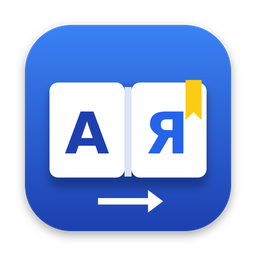

**English** | [Українська](README.uk.md)

<p align="center">
  
</p>

# VocabApp

A macOS menu bar app that builds your personal English–Ukrainian (and Italian) vocabulary from any app in two clicks.

## Overview

Select a word or phrase anywhere on your Mac — Safari, Chrome, Notes, TextEdit, a PDF — right-click and choose
**Services → Add to Dictionary**. VocabApp asks Claude for the translation, pronunciation, part of speech and an
example sentence, saves the entry to a local dictionary and confirms with a system notification. The main window
lets you browse, search, edit and listen to your words.

## Features

| Area | What you get |
|------|--------------|
| Add from any app | A **Services** context-menu item (“Add to Dictionary”) works in any app that supports macOS Services; words can also be added manually. |
| Claude-powered entries | Ukrainian translations, IPA transcription, part of speech and an example sentence with translation. Translations and examples are tuned for software development and QA (e.g. `flaky` → “нестабільний”). |
| English and Italian | Every entry has an English and an Italian rendering, both with Ukrainian translations. An **EN \| IT** switch in the main window toggles between them. You can select an English *or* an Italian word — the language is detected automatically. |
| Token-efficient | One request per new word (both languages at once); existing entries are filled in with Italian in batches of 15; ready data is cached in the dictionary file and never re-requested automatically. Duplicates are detected in both languages without calling the API. |
| Dictionary window | Table view with search (word, lemma, translations; case- and diacritic-insensitive), sorting (newest, oldest, alphabetical) and pagination (20/25/30 per page). |
| Offline-friendly | Words added without a network or an API key wait in a pending queue and are processed automatically later; transient errors are retried, failed entries can be retried manually. |
| Export and import | Export to JSON; import with **Merge** or **Replace** (the current dictionary is backed up first). |
| macOS integration | Menu bar app (no Dock icon), launch at login, text-to-speech for words and examples, light/dark/system theme. |
| Interface language | English or Ukrainian. |

## Requirements

| Requirement | Notes |
|-------------|-------|
| macOS 13 Ventura or later | |
| Xcode 15 or later | The full Xcode app is required; Command Line Tools alone are **not** enough. |
| [Homebrew](https://brew.sh) | Used to install XcodeGen. |
| [XcodeGen](https://github.com/yonaskolb/XcodeGen) | Generates `VocabApp.xcodeproj` from `project.yml`. |
| Anthropic API key | Create one at [console.anthropic.com](https://console.anthropic.com/). |
| Git | To clone and update the repository. |

There are no third-party dependencies.

## Installation

```sh
git clone https://github.com/JacksonMar/dictionary.git VocabApp
cd VocabApp
brew install xcodegen
xcodegen generate
xcodebuild -project VocabApp.xcodeproj -scheme VocabApp -configuration Release -derivedDataPath build CODE_SIGN_IDENTITY=- build
osascript -e 'quit app "VocabApp"' 2>/dev/null; rm -rf /Applications/VocabApp.app
cp -R build/Build/Products/Release/VocabApp.app /Applications/
/System/Library/CoreServices/pbs -update
open /Applications/VocabApp.app
```

The app is signed locally with an ad-hoc signature (`CODE_SIGN_IDENTITY=-`); no Apple Developer account is
needed. Install it in `/Applications`: macOS registers Services and login items only for installed apps.

### Updating

```sh
cd VocabApp
git pull
xcodegen generate
xcodebuild -project VocabApp.xcodeproj -scheme VocabApp -configuration Release -derivedDataPath build CODE_SIGN_IDENTITY=- build
osascript -e 'quit app "VocabApp"' 2>/dev/null; rm -rf /Applications/VocabApp.app
cp -R build/Build/Products/Release/VocabApp.app /Applications/
/System/Library/CoreServices/pbs -update
open /Applications/VocabApp.app
```

Updating replaces only the app bundle. Your dictionary (`~/Library/Application Support/VocabApp`) and the API key
in the Keychain are never touched.

## First launch and setup

1. Open VocabApp. A book icon appears in the menu bar; there is no Dock icon or window — this is expected.
2. Allow notifications when prompted (you can change this later in System Settings → Notifications → VocabApp).
3. Menu bar icon → **Settings…** → enter your Anthropic API key → **Save Key**. The key is stored only in the
   macOS Keychain. The Claude model can be changed in the same window (default: `claude-haiku-5-5`).
4. Interface language: English by default. Change it in Settings → **Interface language / Мова інтерфейсу**; the
   change takes effect after a restart (use **Restart Now**).
5. Enable the service: **System Settings → Keyboard → Keyboard Shortcuts… → Services → Text** and make sure
   **Add to Dictionary** (or **Додати в словник**) is checked. You can also assign a keyboard shortcut there.
   The Services menu title follows the macOS system language, not the app's interface language.

## Usage

- **Add a word from any app:** select a word or phrase (up to 8 words / 120 characters) → right-click →
  **Services → Add to Dictionary**. A notification confirms the result, e.g. “Added: run — бігти, керувати”, or
  tells you the word is already in the dictionary. In some apps the item is only in the app menu → *Services*.
- **Browse:** menu bar → **Open Dictionary**. Search, sort and page through entries; double-click a row to edit;
  use the context menu to speak, retry or delete.
- **EN | IT switch:** in the toolbar of the main window. **IT** shows the Italian rendering of each entry (word,
  IPA, Ukrainian translations, Italian example). Search and alphabetical sorting follow the selected language.
- **Manual add:** the **+** button in the toolbar; fill in the fields yourself or use **Fill In with Claude**.
- **Pending and retry:** entries waiting for processing or failed are marked in the table; use **Retry** on a row,
  **Retry All** in the toolbar, or **Retry Pending** in the menu bar.

## Data and privacy

| Item | Location / behavior |
|------|---------------------|
| Dictionary | `~/Library/Application Support/VocabApp/dictionary.json` (JSON, `schemaVersion: 1`) |
| Backups | `~/Library/Application Support/VocabApp/Backups/` (the 10 most recent copies are kept) |
| API key | Only in the macOS Keychain (service `com.vocabapp.VocabApp`, account `anthropic-api-key`). Never written to code, logs, `UserDefaults`, the dictionary file or exports. |
| Network | Only the selected word or phrase (with the prompt) is sent to the Anthropic API. Nothing else leaves your Mac. |

## Moving to another Mac

1. On the old Mac: Settings → **Transfer** → **Export…** and save the JSON file.
2. Copy the file to the new Mac and install VocabApp there.
3. On the new Mac: Settings → **Import…** → choose the file and a mode:

| Mode | Behavior |
|------|----------|
| **Merge** (default) | New entries are added; if a word already exists, the more recently changed entry wins. |
| **Replace…** | The current dictionary is replaced by the file after confirmation; it is first saved to `~/Library/Application Support/VocabApp/Backups/`. |

An invalid file never changes the dictionary. The API key is **not** exported — enter it again in Settings on the
new Mac; pending words are then processed automatically.

## Uninstall

```sh
osascript -e 'quit app "VocabApp"' 2>/dev/null
rm -rf /Applications/VocabApp.app
# Optional: delete your dictionary and backups
rm -rf ~/Library/Application\ Support/VocabApp
# Optional: delete the API key from the Keychain
security delete-generic-password -s com.vocabapp.VocabApp -a anthropic-api-key
```

If launch at login was enabled, turn it off in Settings before uninstalling, or remove VocabApp in
System Settings → General → Login Items.

## Troubleshooting

| Problem | Solution |
|---------|----------|
| “Add to Dictionary” is not in the Services menu | Make sure the app is in `/Applications` and has been launched once. Run `/System/Library/CoreServices/pbs -flush` and `/System/Library/CoreServices/pbs -update`, enable the item in System Settings → Keyboard → Keyboard Shortcuts… → Services → Text, and restart the app where you select text. If it is still missing, log out and log back in. |
| macOS refuses to open the app (Gatekeeper) | Happens when the `.app` was copied from another computer: `xattr -dr com.apple.quarantine /Applications/VocabApp.app`, or right-click the app → Open. |
| Keychain asks for access after a rebuild | Each ad-hoc build has a new signature. Click **Always Allow**, or re-enter the key in Settings. |
| No notifications | Check System Settings → Notifications → VocabApp. The last result is also shown in the menu bar menu. |
| No speech | Add an English or Italian voice: System Settings → Accessibility → Spoken Content → System Voice → Manage Voices. |
| `swift test` fails with `unable to resolve module dependency: 'XCTest'` | Install the full Xcode and run `sudo xcode-select -s /Applications/Xcode.app/Contents/Developer`. |

Logs (the API key is never logged):
`log show --last 30m --predicate 'subsystem == "com.vocabapp.VocabApp"' --info`

## Development

```
Package.swift          VocabCore Swift package (Foundation only; builds on macOS and Linux)
project.yml            XcodeGen project description
Sources/VocabCore/     Core: model, storage, Claude API client, queue, import/export, localization
Tests/VocabCoreTests/  Core tests
App/                   macOS app: SwiftUI/AppKit UI, Services provider, Keychain, notifications
App/Tests/             App tests (macOS only)
docs/development/      Architecture, requirements, progress and manual test checklists
```

```sh
# Core tests (macOS with full Xcode, or Linux via Docker)
swift test
docker run --rm -v "$PWD":/w -w /w swift:6.0-noble swift test

# App tests (macOS)
xcodegen generate && xcodebuild test -project VocabApp.xcodeproj -scheme VocabApp \
  -destination 'platform=macOS' -derivedDataPath build CODE_SIGN_IDENTITY=-
```

Tests make no network requests and never touch your real dictionary. Contributor documentation lives in
[`docs/development/`](docs/development/).

## License

[MIT](LICENSE)
