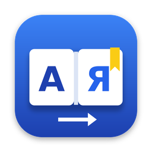

[English](README.md) | **Українська**

<p align="center">
  
</p>

# VocabApp

Застосунок для рядка меню macOS (і [застосунок для iPhone](#iphone)), що за два кліки збирає ваш особистий англо-український (та італійський) словник з будь-якої програми.

## Огляд

Виділіть слово чи фразу будь-де на Mac — у Safari, Chrome, Notes, TextEdit, PDF — натисніть праву кнопку миші й
виберіть **Services → Додати в словник**. VocabApp запитає в Claude переклад, вимову, частину мови й приклад
речення, збереже запис у локальний словник і підтвердить це системним сповіщенням. У головному вікні слова можна
переглядати, шукати, редагувати й прослуховувати.

## Можливості

| Напрям | Що ви отримуєте |
|--------|-----------------|
| Додавання з будь-якої програми | Пункт контекстного меню **Services** («Додати в словник») працює в будь-якій програмі, що підтримує служби macOS; слова також можна додавати вручну. |
| Записи на основі Claude | Українські переклади, транскрипція IPA, частина мови й приклад речення з перекладом. Переклади й приклади орієнтовані на розробку ПЗ і QA (наприклад, `flaky` → «нестабільний»). |
| Англійська й італійська | Кожен запис має англійську та італійську версії, обидві з українськими перекладами. Перемикач **EN \| IT** у головному вікні перемикає між ними. Можна виділити англійське *або* італійське слово — мова визначається автоматично. |
| Економія токенів | Один запит на нове слово (обидві мови одразу); наявні записи доповнюються італійською пакетами по 15; готові дані кешуються у файлі словника й автоматично ніколи не запитуються повторно. Дублікати виявляються в обох мовах без звернення до API. |
| Вікно словника | Таблиця з пошуком (слово, лема, переклади; без урахування регістру й діакритики), сортуванням (спершу нові, спершу старі, за алфавітом) і сторінками (20/25/30 записів). |
| Робота без мережі | Слова, додані без мережі чи API-ключа, чекають у черзі й обробляються автоматично пізніше; тимчасові помилки повторюються, записи з помилкою можна повторити вручну. |
| Експорт та імпорт | Експорт у JSON; імпорт у режимі **Об'єднати** або **Замінити** (поточний словник спершу зберігається в резервну копію). |
| Інтеграція з macOS | Застосунок у рядку меню (без іконки в Dock), автозапуск при вході в систему, озвучення слів і прикладів, світла/темна/системна тема. |
| Мова інтерфейсу | Англійська або українська. |

## Вимоги

| Вимога | Примітки |
|--------|----------|
| macOS 13 Ventura або новіша | |
| Xcode 15 або новіший | Потрібен повний застосунок Xcode; самих Command Line Tools **недостатньо**. |
| [Homebrew](https://brew.sh) | Для встановлення XcodeGen. |
| [XcodeGen](https://github.com/yonaskolb/XcodeGen) | Генерує `VocabApp.xcodeproj` з `project.yml`. |
| API-ключ Anthropic | Створіть на [console.anthropic.com](https://console.anthropic.com/). |
| Git | Для клонування й оновлення репозиторію. |

Сторонніх залежностей немає.

## Встановлення

```sh
git clone https://github.com/JacksonMar/dictionary.git VocabApp
cd VocabApp
brew install xcodegen
xcodegen generate
xcodebuild -project VocabApp.xcodeproj -scheme VocabApp -configuration Release -derivedDataPath build CODE_SIGN_IDENTITY=- build
osascript -e 'quit app "VocabApp"' 2>/dev/null; rm -rf /Applications/VocabApp.app
cp -R build/Build/Products/Release/VocabApp.app /Applications/
/System/Library/CoreServices/pbs -update
open /Applications/VocabApp.app
```

Застосунок підписується локально ad-hoc підписом (`CODE_SIGN_IDENTITY=-`); обліковий запис Apple Developer не
потрібен. Встановлюйте саме в `/Applications`: macOS реєструє служби й автозапуск лише для встановлених
застосунків.

### Оновлення

```sh
cd VocabApp
git pull
xcodegen generate
xcodebuild -project VocabApp.xcodeproj -scheme VocabApp -configuration Release -derivedDataPath build CODE_SIGN_IDENTITY=- build
osascript -e 'quit app "VocabApp"' 2>/dev/null; rm -rf /Applications/VocabApp.app
cp -R build/Build/Products/Release/VocabApp.app /Applications/
/System/Library/CoreServices/pbs -update
open /Applications/VocabApp.app
```

Оновлення замінює лише бандл застосунку. Ваш словник (`~/Library/Application Support/VocabApp`) і API-ключ у
Keychain ніколи не змінюються.

## Перший запуск і налаштування

1. Відкрийте VocabApp. У рядку меню з'явиться іконка книжки; іконки в Dock і вікна немає — так і має бути.
2. Дозвольте сповіщення на запит системи (змінити можна згодом у System Settings → Notifications → VocabApp).
3. Іконка в рядку меню → **Settings…** (**Налаштування…**) → введіть API-ключ Anthropic → **Save Key**
   (**Зберегти ключ**). Ключ зберігається лише в Keychain macOS. Модель Claude можна змінити в тому самому вікні
   (за замовчуванням `claude-haiku-5-5`).
4. Мова інтерфейсу: за замовчуванням англійська. Змінити її можна в Settings → **Interface language / Мова
   інтерфейсу**; зміна діє після перезапуску (кнопка **Restart Now** / **Перезапустити зараз**).
5. Увімкніть службу: **System Settings → Keyboard → Keyboard Shortcuts… → Services → Text** і переконайтеся, що
   пункт **Додати в словник** (або **Add to Dictionary**) позначено. Там само можна призначити сполучення клавіш.
   Назва пункту в меню Services залежить від мови системи macOS, а не від мови інтерфейсу застосунку.

## Використання

- **Додати слово з будь-якої програми:** виділіть слово чи фразу (до 8 слів / 120 символів) → права кнопка миші →
  **Services → Додати в словник**. Сповіщення підтвердить результат, наприклад «Додано: run — бігти, керувати»,
  або повідомить, що слово вже є в словнику. У деяких програмах пункт є лише в меню програми → *Services*.
- **Перегляд:** рядок меню → **Open Dictionary** (**Відкрити словник**). Шукайте, сортуйте й гортайте записи;
  подвійний клік по рядку — редагування; контекстне меню — озвучити, повторити чи видалити.
- **Перемикач EN | IT:** на панелі інструментів головного вікна. **IT** показує італійську версію кожного запису
  (слово, IPA, українські переклади, приклад італійською). Пошук і сортування за алфавітом враховують вибрану мову.
- **Ручне додавання:** кнопка **+** на панелі інструментів; заповніть поля самостійно або натисніть **Fill In with
  Claude** (**Заповнити через Claude**).
- **Черга й повтор:** записи, що очікують обробки або завершилися помилкою, позначені в таблиці; скористайтеся
  **Retry** (**Повторити**) у рядку, **Retry All** (**Повторити всі**) на панелі інструментів або **Retry
  Pending** (**Повторити очікувані**) у рядку меню.

## Дані та приватність

| Що | Розташування / поведінка |
|----|--------------------------|
| Словник | `~/Library/Application Support/VocabApp/dictionary.json` (JSON, `schemaVersion: 1`) |
| Резервні копії | `~/Library/Application Support/VocabApp/Backups/` (зберігаються 10 останніх копій) |
| API-ключ | Лише в Keychain macOS (служба `com.vocabapp.VocabApp`, обліковий запис `anthropic-api-key`). Ніколи не записується в код, логи, `UserDefaults`, файл словника чи експорт. |
| Мережа | На API Anthropic надсилається лише виділене слово чи фраза (разом із промтом). Більше ніщо не залишає ваш Mac. |

## Перенесення на інший Mac

1. На старому Mac: Settings → **Transfer** (**Перенесення**) → **Export…** (**Експортувати…**) і збережіть JSON-файл.
2. Скопіюйте файл на новий Mac і встановіть там VocabApp.
3. На новому Mac: Settings → **Import…** (**Імпортувати…**) → виберіть файл і режим:

| Режим | Поведінка |
|-------|-----------|
| **Merge** / **Об'єднати** (за замовчуванням) | Нові записи додаються; якщо слово вже є, перемагає запис із пізнішою зміною. |
| **Replace…** / **Замінити…** | Після підтвердження поточний словник замінюється вмістом файлу; перед цим він зберігається в `~/Library/Application Support/VocabApp/Backups/`. |

Невалідний файл ніколи не змінює словник. API-ключ **не** експортується — введіть його ще раз у Settings на
новому Mac; після цього слова з черги обробляться автоматично.

## Видалення

```sh
osascript -e 'quit app "VocabApp"' 2>/dev/null
rm -rf /Applications/VocabApp.app
# Необов'язково: видалити словник і резервні копії
rm -rf ~/Library/Application\ Support/VocabApp
# Необов'язково: видалити API-ключ з Keychain
security delete-generic-password -s com.vocabapp.VocabApp -a anthropic-api-key
```

Якщо було ввімкнено автозапуск, вимкніть його в Settings перед видаленням або приберіть VocabApp у
System Settings → General → Login Items.

## Усунення несправностей

| Проблема | Рішення |
|----------|---------|
| У меню Services немає «Додати в словник» | Переконайтеся, що застосунок лежить у `/Applications` і був запущений хоча б раз. Виконайте `/System/Library/CoreServices/pbs -flush` і `/System/Library/CoreServices/pbs -update`, увімкніть пункт у System Settings → Keyboard → Keyboard Shortcuts… → Services → Text і перезапустіть програму, у якій виділяєте текст. Якщо пункту все ще немає — вийдіть з облікового запису macOS і увійдіть знову. |
| macOS не відкриває застосунок (Gatekeeper) | Буває, коли `.app` скопійовано з іншого комп'ютера: `xattr -dr com.apple.quarantine /Applications/VocabApp.app` або права кнопка на застосунку → Open. |
| Keychain просить доступ після перезбірки | Кожна ad-hoc збірка має новий підпис. Натисніть **Always Allow** (**Завжди дозволяти**) або введіть ключ у Settings ще раз. |
| Немає сповіщень | Перевірте System Settings → Notifications → VocabApp. Останній результат також видно в меню застосунку в рядку меню. |
| Немає озвучення | Додайте англійський чи італійський голос: System Settings → Accessibility → Spoken Content → System Voice → Manage Voices. |
| `swift test` падає з `unable to resolve module dependency: 'XCTest'` | Встановіть повний Xcode і виконайте `sudo xcode-select -s /Applications/Xcode.app/Contents/Developer`. |

Логи (API-ключ ніколи не логується):
`log show --last 30m --predicate 'subsystem == "com.vocabapp.VocabApp"' --info`

## iPhone

VocabApp має й застосунок для iPhone (iOS 17+), що працює з тим самим форматом словника. Він встановлюється з Xcode
на вашому Mac — збірки в App Store немає. Достатньо безкоштовного Apple ID.

### Вимоги

| Вимога | Примітки |
|--------|----------|
| Mac з Xcode 16 або новішим | Повний Xcode і [XcodeGen](https://github.com/yonaskolb/XcodeGen) (`brew install xcodegen`). |
| iPhone з iOS 17 або новішою | Кабель USB для першої установки. |
| Apple ID | Підходить безкоштовний Apple ID (Personal Team); платний акаунт розробника — необов'язковий. |
| API-ключ Anthropic | Такий самий, як на Mac; на iPhone вводиться окремо. |

### Налаштування підпису (один раз)

Ваш Team ID і префікс bundle ID зберігаються лише в `Config/Local.xcconfig`, який є в `.gitignore`, — **ніколи не
комітьте його**.

1. `cp Config/Local.example.xcconfig Config/Local.xcconfig`
2. Дізнайтеся Team ID: Xcode → Settings → Accounts → додайте свій Apple ID (з'явиться «Personal Team»). Відкрийте
   `VocabApp.xcodeproj` → таргет **VocabMobile** → Signing & Capabilities → оберіть команду, далі Build Settings →
   `DEVELOPMENT_TEAM` і скопіюйте значення з 10 символів.
3. У `Config/Local.xcconfig` впишіть це значення у `VOCAB_DEVELOPMENT_TEAM`, а у `VOCAB_BUNDLE_ID_PREFIX` — власний
   унікальний префікс, напр. `com.<ваш-нік>.vocab` (bundle ID глобальні; безкоштовний акаунт може зареєструвати лише
   кілька нових App ID на тиждень, тож не змінюйте префікс без потреби).
4. `xcodegen generate`

Ті самі кроки описано в коментарях `Config/Local.example.xcconfig`.

### Установка

1. На iPhone: Settings → Privacy & Security → **Developer Mode** → увімкнути (iPhone перезавантажиться).
2. Під'єднайте iPhone, відкрийте `VocabApp.xcodeproj`, оберіть схему **VocabMobile** і свій iPhone, натисніть **Run**.
3. Першого разу: на iPhone відкрийте Settings → General → VPN & Device Management → ваш сертифікат розробника →
   **Trust** (**Довіряти**), потім запустіть VocabApp.
4. У VocabApp → ⚙︎ Налаштування введіть API-ключ Anthropic.

**Кожні 7 днів** (безкоштовний Apple ID) застосунок перестає запускатися, доки його не підписати знову: під'єднайте
iPhone і ще раз натисніть **Run** у Xcode. Словник зберігається, якщо не видаляти застосунок. Перед видаленням або
перевстановленням спершу експортуйте словник (див. нижче).

### Можливості на iPhone

| Можливість | Як |
|------------|----|
| Словник | Список з пошуком, сортуванням, перемикачем **EN \| IT**, деталями, редагуванням, озвученням; потягніть список донизу, щоб повторити записи, що очікують. |
| Голосове введення | Кнопка мікрофона → скажіть англійське чи італійське слово (перемикач **EN \| IT**); розпізнане слово завжди показується для підтвердження — нічого не додається, доки ви не натиснете **Додати**. |
| «Поділитися» | Виділіть слово в Safari, Mail, Notes… → **Поділитися** → **VocabApp**; слово додасться під час наступного відкриття застосунку. |
| Siri і Швидкі команди | «Add a word to VocabApp», «Add a word by voice to VocabApp» (фрази Siri — лише англійською); обидві дії є й у застосунку «Швидкі команди», їх можна призначити на кнопку дії (Action Button). |
| Віджет | «Add by Voice» на екрані «Додому» або екрані блокування відкриває голосове введення й одразу слухає. |

Витрата токенів — як на Mac: один запит на нове слово, жодного — на дубль.

### Синхронізація з Mac

Автоматичної синхронізації немає — файл (`dictionary.json`, однаковий формат на обох пристроях) переносите вручну.

- **Mac → iPhone:** на Mac — Settings → **Export…**; надішліть файл через AirDrop (він потрапить у «Файли» →
  «Завантаження») або покладіть в iCloud Drive. На iPhone: ⚙︎ Налаштування → **Синхронізація з Mac** →
  **Імпортувати з «Файлів»…** → оберіть файл → **Об'єднати** або **Замінити…**.
- **iPhone → Mac:** ⚙︎ Налаштування → **Експортувати у «Файли»…** зберігає файл у «Файлах». Щоб надіслати його через
  **AirDrop**, спершу збережіть у «Файли», потім відкрийте файл там і натисніть **Поділитися** → AirDrop. На Mac:
  Settings → **Import…**.

| Режим | Поведінка |
|-------|-----------|
| **Об'єднати** (за замовчуванням) | Нові записи додаються; якщо слово є на обох пристроях, перемагає запис, змінений пізніше. Італійські версії об'єднуються. |
| **Замінити…** | Після підтвердження словник замінюється вмістом файлу; поточний спершу зберігається в Backups. |

**Видалення не синхронізуються:** слово, видалене на одному пристрої, повернеться після «Об'єднати» з іншого. Щоб
прибрати слова всюди, видаліть їх на одному пристрої й використайте **Замінити…** на іншому. Записи з файлу, що
очікують перекладу, перекладаються після імпорту (один запит на слово). Невалідний файл ніколи не змінює словник.

### API-ключ і дані на iPhone

API-ключ зберігається лише в Keychain застосунку VocabApp на iPhone — він не експортується й не передається на Mac;
введіть його на кожному пристрої. Словник і резервні копії лежать у контейнері застосунку
(`Library/Application Support/VocabApp`; точний шлях показано в ⚙︎ Налаштуваннях) і видаляються разом із застосунком.

### Усунення несправностей на iPhone

| Проблема | Рішення |
|----------|---------|
| Xcode: «No profiles…» / помилки підпису | Перевірте `VOCAB_DEVELOPMENT_TEAM` і унікальність префікса, ще раз виконайте `xcodegen generate`. Команда, обрана в Xcode, зникає після перегенерації — тримайте її в `Config/Local.xcconfig`. |
| «Untrusted Developer» під час запуску | Settings → General → VPN & Device Management → довірте сертифікат. |
| Через тиждень застосунок перестав відкриватися | Безкоштовний профіль закінчився: під'єднайте iPhone і натисніть **Run** у Xcode (дані зберігаються). |
| VocabApp немає в меню «Поділитися» або він пише, що спільна папка недоступна | App Group недоступна для вашої команди підпису. Запасний варіант — Швидкі команди: створіть команду «Отримати текст з меню „Поділитися“ → Add to Dictionary (VocabApp)» і діліться словом із цією командою. |
| Голос: італійське слово розпізнається погано | Виправте його в текстовому полі перед **Додати**; без мережі італійська може бути недоступна, якщо розпізнавання на пристрої не встановлене. |
| Siri не розуміє | Фрази Siri працюють англійською; для інших мов використовуйте «Швидкі команди». |

## Розробка

```
Package.swift          Swift-пакет VocabCore (лише Foundation; збирається на macOS і Linux)
project.yml            опис проєкту для XcodeGen
Sources/VocabCore/     ядро: модель, сховище, клієнт Claude API, черга, імпорт/експорт, локалізація
Tests/VocabCoreTests/  тести ядра
App/                   застосунок macOS: інтерфейс SwiftUI/AppKit, провайдер Services, Keychain, сповіщення
App/Tests/             тести застосунку (лише macOS)
Mobile/                застосунок для iPhone (SwiftUI, iOS 17): голос, App Intents, перенесення; Mobile/Tests — iOS-тести
Extensions/            розширення «Поділитися» і віджет для iPhone
Config/                налаштування підпису (Local.example.xcconfig → ваш Local.xcconfig, у .gitignore)
docs/development/      архітектура, вимоги, стан розробки й ручні чеклісти
```

```sh
# Тести ядра (macOS з повним Xcode або Linux через Docker)
swift test
docker run --rm -v "$PWD":/w -w /w swift:6.0-noble swift test

# Тести застосунку (macOS)
xcodegen generate && xcodebuild test -project VocabApp.xcodeproj -scheme VocabApp \
  -destination 'platform=macOS' -derivedDataPath build CODE_SIGN_IDENTITY=-

# Тести застосунку для iPhone (симулятор)
xcodebuild test -project VocabApp.xcodeproj -scheme VocabMobile \
  -destination 'platform=iOS Simulator,name=iPhone 16'
```

Тести не роблять мережевих запитів і не чіпають ваш справжній словник. Документація для розробників —
у [`docs/development/`](docs/development/).

## Ліцензія

[MIT](LICENSE)
